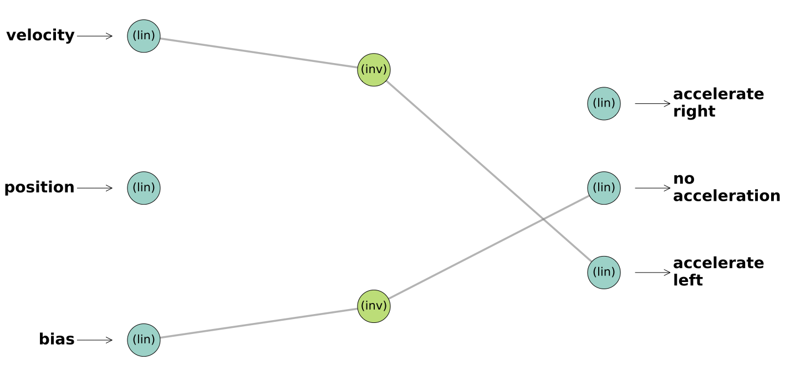
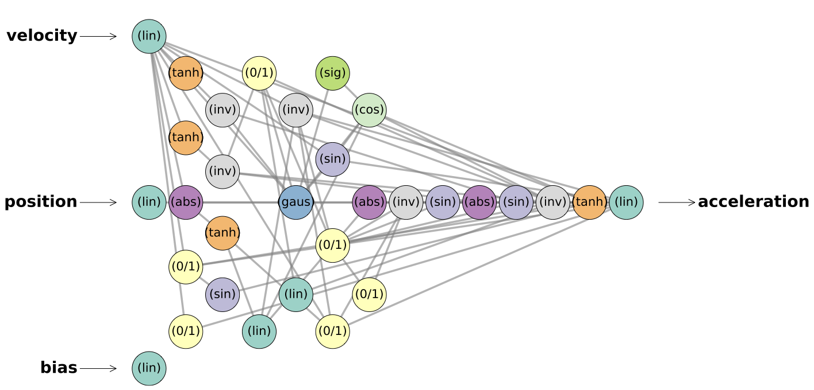
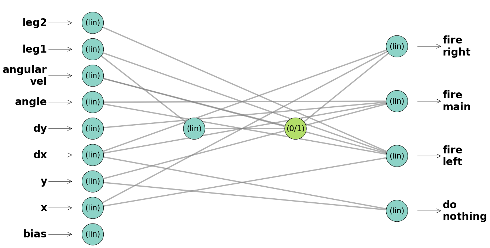
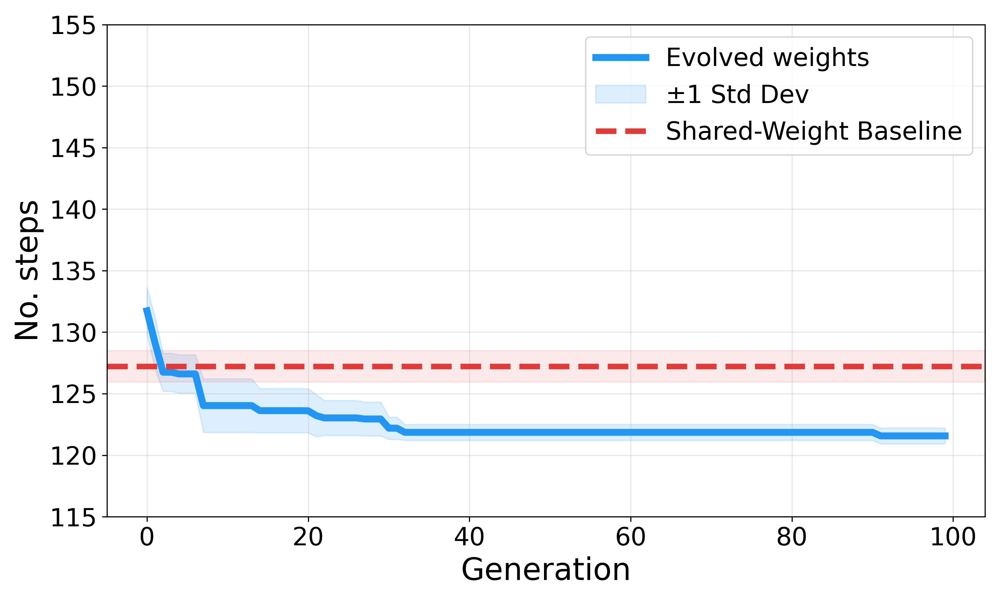
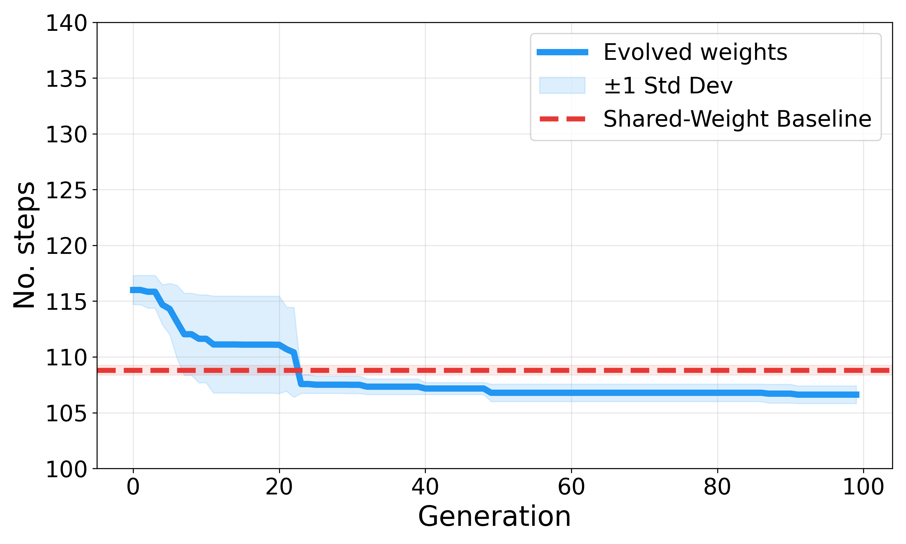
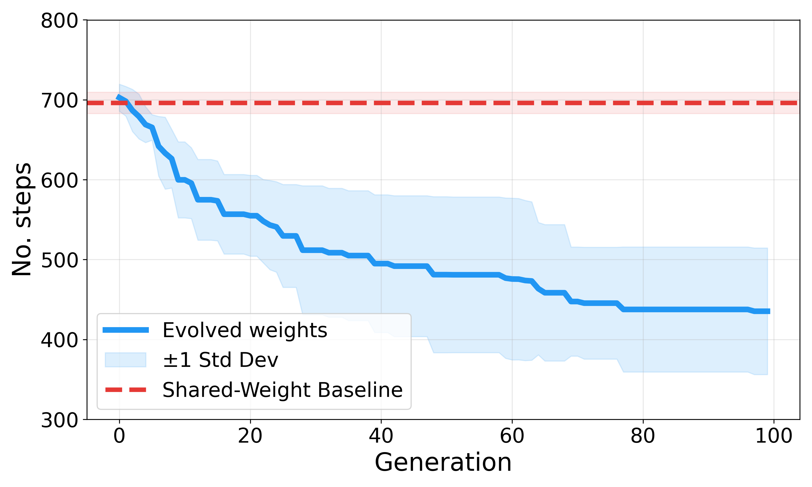

# Are Weight Agnostic Neural Networks Truly Weight Agnostic?

**An Empirical Analysis via Evolution Strategies**

> This project investigates whether the performance of Weight Agnostic Neural Networks (WANNs) in sparse reward environments can be improved through targeted weight optimization using OpenAI Evolution Strategies (ES). The answer depends on the task: on Sparse Mountain Car the topology alone drives the solution and weight tuning brings no gain, while on Lunar Lander, where the topology lands in less than half of the episodes, weight optimization clearly improves performance.

📄 **[Read the Full Paper (PDF)]()**

---

## Table of Contents

- [Overview](#overview)
- [Contributions](#contributions)
- [Key Findings](#key-findings)
- [Environments](#environments)
- [Network Topologies](#network-topologies)
- [Results](#results)
- [Installation](#installation)
- [Usage](#usage)
  - [1. Train WANN Topologies](#1-train-wann-topologies)
  - [2. Train Individual Weights via ES](#2-train-individual-weights-via-es)
  - [3. Run Multiple Trials and Aggregate Data](#3-run-multiple-trials-and-aggregate-data)
  - [4. Plot Aggregated Data Manually](#4-plot-aggregated-data-manually)
  - [5. Visualize Network Topologies](#5-visualize-network-topologies)
- [Acknowledgements](#acknowledgements)
- [License](#license)

---

## Overview

[Weight Agnostic Neural Networks (WANNs)](https://arxiv.org/abs/1906.04358) discover network architectures that can solve tasks even when all connections share a single, uniform weight value. This makes them particularly effective in **sparse reward** environments, where traditional RL algorithms (PPO, DQN, Q-Learning) fail due to the lack of dense gradient information.

This project extends the work of [Lingenberg & Reuter (2025)](https://github.com/Tobi-Tob/Sparse-RL-Wann) by:

1. **Reconstructing** the optimal WANN topologies in **PyTorch** (with verified numerical equivalence to the original NumPy implementation).
2. **Applying OpenAI Evolution Strategies (ES)** to optimize individual connection weights of these fixed topologies.
3. **Showing** that targeted weight optimization yields **no performance improvement** over the shared-weight baseline on Sparse Mountain Car, but a **clear improvement** on Lunar Lander: the weight-agnostic hypothesis holds, but not universally.

---

## Contributions

The following scripts represent the main contributions of this project, built on top of the original [Sparse-RL-Wann](https://github.com/Tobi-Tob/Sparse-RL-Wann) codebase:

| Script | Description |
|:---|:---|
| `train_wann_weights.py` | ES weight optimization for WANN topologies. Runs the full training pipeline: shared-weight baseline evaluation, evolutionary weight optimization, statistical testing, and training curve generation. |
| `run_multiple_trials.py` | Executes multiple sequential training trials for a given environment across different random seeds, aggregates the resulting CSV data, and generates shaded statistical plots. |
| `plot_multiple_trials.py` | Parses CSV logs from multiple individual runs, calculates statistical metrics (mean and standard deviation), and creates shaded aggregated training curves to visualize performance variability. |
| `convert_wann.py` | PyTorch re-implementation of the WANN forward pass. Converts `.out` topology files into differentiable `nn.Module` objects, supporting both shared-weight and individual-weight modes. |
| `verify_consistency.py` | Numerical equivalence check between the original NumPy forward pass and the PyTorch re-implementation, ensuring identical outputs. |
| `print_networks.py` | Network topology visualization. Generates high-resolution PDF renderings of the evolved WANN architectures with labeled inputs, outputs, and activation functions. |

---

## Key Findings

| Configuration | SMC Discrete | SMC Continuous | Lunar Lander |
|:---|:---:|:---:|:---:|
| Shared Baseline | **129.4 ± 33.7** | 109.3 ± 12.5 | 672.8 ± 355.3 (48% landings) |
| ES Trained | 130.2 ± 33.4 | **108.8 ± 14.0** | **416.8 ± 258.7 (86% landings)** |
| Welch's t-test p-value | 0.80 | 0.74 | < 0.001 |

> *Average steps ± std. dev. over 200 episodes (lower is better), for the run with the median final performance of the ES-trained weights (run 2 of 5). Failed episodes count as the maximum episode length (200 steps for SMC, 1000 for Lunar Lander).*

- **Sparse Mountain Car: no gain from weight tuning.** ES and the shared-weight baseline are statistically equivalent in all five runs, from 4 connections (Discrete) to 71 connections (Continuous).
- **Lunar Lander: clear gain from weight tuning.** In all five runs the ES-trained weights land in 62–96% of the episodes, against 43–48% for the shared-weight baseline (p ≤ 0.004 in every run).
- **What makes the difference** is not the network size but how well the topology already solves the task: the Sparse Mountain Car networks always reach the goal, the Lunar Lander network (17 connections) lands in less than half of the episodes.

---

## Environments

All three environments use **sparse reward** formulations, where the agent receives non-zero feedback only upon successful task completion:

| Environment | State Dim | Action Space | Reward |
|:---|:---:|:---|:---|
| **Sparse Mountain Car (Discrete)** | 2 | 3 discrete actions (left, none, right) | R_t = 100 · 0.99^t on success, 0 otherwise |
| **Sparse Mountain Car (Continuous)** | 2 | 1 continuous value ∈ [-1, 1] | R_t = 100 · 0.99^t on success, 0 otherwise |
| **Lunar Lander** | 8 | 4 discrete actions (noop, left, main, right) | R_t = 100 · 0.999^t on safe landing, 0 otherwise |

---

## Network Topologies

The optimal WANN topologies discovered by [Lingenberg & Reuter](https://github.com/Tobi-Tob/Sparse-RL-Wann) and reconstructed in PyTorch. Nodes indicate the activation function used; edges represent connections whose weights are assigned a uniform shared value for baseline evaluation.

### Sparse Mountain Car - Discrete (2 hidden nodes, 4 connections)

<p align="center">
  
</p>

### Sparse Mountain Car - Continuous (31 nodes, 71 connections)

<p align="center">
  
</p>

### Lunar Lander (2 hidden nodes, 17 connections)

> The champion file `champions/lula_best.out` inherited from the original repository comes from a weaker run (`lula_1024_128`) that never lands. This project uses the best network reported by the original authors, `log/lula/lula_256_480_best.out`.

<p align="center">
  
</p>

---

## Results

The multi-run aggregated training curves below show, for each generation, the lowest step count achieved so far by the ES policy (mean ± std. dev. over five runs), against the shared-weight baseline (red dashed line: mean over the five runs ± std. dev.).

### Sparse Mountain Car - Discrete

<p align="center">
  
</p>

### Sparse Mountain Car - Continuous

<p align="center">
  
</p>

### Lunar Lander

<p align="center">
  
</p>

On Sparse Mountain Car, the curves drop slightly below the shared-weight baseline, but this improvement does not hold in the final evaluation: over 200 new episodes, the optimized weights perform at the baseline level. The gap comes from selection bias: each curve is a running minimum of noisy 100-episode estimates, so it is optimistic. Re-evaluating the fixed baseline in the same way, without any optimization, gives the same gap (120.8–122.9 steps on SMC Discrete).

On Lunar Lander, the curve drops from about 700 to about 435 steps, and the final evaluation confirms most of this improvement (474.7 steps on average over the five runs). Most of the gain comes from a higher landing rate: in successful episodes, the number of steps stays close to the baseline.

> Network size does not explain the difference. Weight tuning brings no gain on the 71-connection Sparse Mountain Car (Continuous) network, but a clear gain on the 17-connection Lunar Lander network. What matters is how well the topology already solves the task with a single shared weight: when it does, as on Sparse Mountain Car, the control policy is encoded in the topology itself; when it does not, as on Lunar Lander, the topology is a good starting point for weight optimization.

---

## Installation

**Prerequisites:** Python 3.8+ with `pip`.

```bash
# Clone the repository
git clone https://github.com/DanieleBordignon/Sparse-RL-WANN-PyTorch-ES.git
cd Sparse-RL-WANN-PyTorch-ES

# Install dependencies
pip install -r requirements.txt
```

---

## Usage

### 1. Train WANN Topologies

Run the evolutionary algorithm to discover new WANN architectures (from the [original codebase](https://github.com/Tobi-Tob/Sparse-RL-Wann)):

```bash
python wann_train.py
```

Pre-evolved champion networks for all three environments are already provided in `champions/`.

### 2. Train Individual Weights via ES

Run the OpenAI Evolution Strategies weight optimizer on a selected environment:

```bash
python train_wann_weights.py --env smc_discrete --seed 101
```

`--env` selects the target environment (`smc_discrete`, `smc_continuous` or `lunar_lander`); `--seed` makes the run reproducible; `--run_id` adds a suffix to the output files.

**Training configuration:**

| Parameter | Value | Description |
|:---|:---:|:---|
| `POP_SIZE` | 16 | Population size (×2 with antithetic sampling = 32 candidates) |
| `GENERATIONS` | 100 | Number of ES generations |
| `LEARNING_RATE` | 0.05 | Step size for weight updates |
| `SIGMA` | 0.05 | Noise standard deviation for perturbations |
| `N_EVALS_PER_CAND` | 100 | Episodes per candidate evaluation |

**Output:**
- Console log with per-generation statistics (population avg, policy eval, best overall, success rate)
- Training curves in `plots/Latex/` (PDF) and `plots/png/` (PNG)
- Per-episode, per-generation and summary data in `plots/csv/`
- Final weights in `plots/weights/<env_name>.npz`
- Welch's t-test comparing baseline vs. trained weights (200-episode evaluation)

Failed episodes (timeout, or crash and out-of-bounds in Lunar Lander) are counted as the maximum episode length: 200 steps for Sparse Mountain Car, 1000 for Lunar Lander.

### 3. Run Multiple Trials and Aggregate Data

Execute multiple sequential training runs to assess variance and automatically generate shaded statistical plots:

```bash
python run_multiple_trials.py --env smc_discrete smc_continuous lunar_lander
```

Each environment runs five times with seeds 101–105; several environments run one after the other. The results reported above come from this command.

### 4. Plot Aggregated Data Manually

If you already have the CSV logs from multiple runs and just want to regenerate the shaded plots:

```bash
python plot_multiple_trials.py --env smc_discrete
```

### 5. Visualize Network Topologies

Generate high-resolution PDF visualizations of all three WANN architectures:

```bash
python print_networks.py
```

---

## Acknowledgements

This project builds upon:

- **[Sparse-RL-Wann](https://github.com/Tobi-Tob/Sparse-RL-Wann)** by Lingenberg & Reuter, WANN topology evolution and sparse environment implementations.
- **[Weight Agnostic Neural Networks](https://arxiv.org/abs/1906.04358)** (Gaier & Ha, NeurIPS 2019), original WANN framework from [Google Brain Tokyo Workshop](https://github.com/google/brain-tokyo-workshop/tree/master/WANNRelease).
- **[Evolution Strategies as a Scalable Alternative to Reinforcement Learning](https://arxiv.org/abs/1703.03864)** (Salimans et al., 2017), OpenAI ES algorithm.

---

## License

This project is licensed under the **Apache License 2.0**, see [LICENSE](LICENSE) for details.